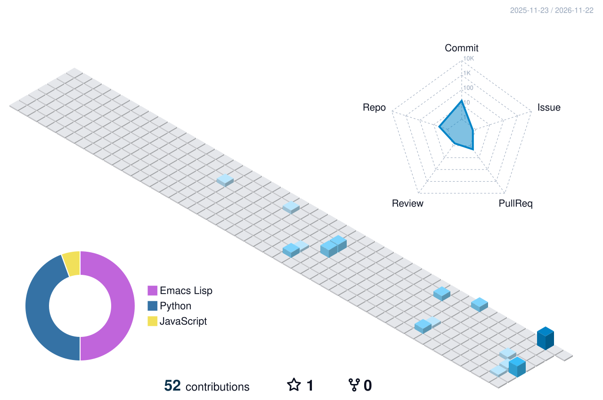

<!--
  GitHub Profile README

  用到的服务 / 插件：
  - 头图      capsule-render（SVG 已存到 assets/，不依赖线上服务）
              https://github.com/kyechan99/capsule-render
  - 徽章      shields.io       https://shields.io
  - 仓库卡片  github-readme-stats
              https://github.com/anuraghazra/github-readme-stats
  - 开源统计  .github/workflows/open-source-stats.yml
              （每日统计公开仓库中被 merge 的 PR 数和项目数）
  - 3D 贡献图 github-profile-3d-contrib
              https://github.com/yoshi389111/github-profile-3d-contrib
              （conf/profile-3d-contrib.json 定义蓝色系 day/night 两版，
              由 .github/workflows/profile-3d.yml 每天生成并提交）

  仓库名 zyw-icarus 与 GitHub 用户名一致，
  推送到 zyw-icarus/zyw-icarus 后会直接显示在 Profile 页。

  TODO：下面用 ✍️ 标出的文字待补全。
-->

<picture>
  <source media="(prefers-color-scheme: dark)" srcset="./assets/header-dark.svg" />
  <source media="(prefers-color-scheme: light)" srcset="./assets/header-light.svg" />
  
</picture>

  
  
  

<!-- ✍️ 自我介绍：一段不超过 100 字，写完删除这行注释 -->

<em>Hi. I'm Mox, an Emacs-holic from China.</em>

<h2 align="center">Contributions</h2>

<!-- 由 GitHub Actions 每天生成；首次推送后自动生成，也可在 Actions 里手动运行 Update 3D contribution graph -->

  <picture>
    <source media="(prefers-color-scheme: dark)" srcset="./profile-3d-contrib/profile-night.svg" />
    <source media="(prefers-color-scheme: light)" srcset="./profile-3d-contrib/profile-day.svg" />
    
  </picture>

<h2 align="center">Open Source</h2>

Projects I've contributed to.

<!-- 统计数据由 .github/workflows/open-source-stats.yml 每日更新（仅统计公开仓库的 merged PR） -->
<!-- OPEN-SOURCE-STATS:START -->

<strong>2</strong> merged pull requests across <strong>2</strong> projects · latest Nov 2026

<!-- OPEN-SOURCE-STATS:END -->

<!-- 新增项目：复制一组 <a>…</a>，替换 owner/repo、链接和 alt；卡片由 github-readme-stats 生成 -->

  <a href="https://github.com/LeeRolling/dsh-boot-suite">
    <picture>
      <source media="(prefers-color-scheme: dark)" srcset="https://github-readme-stats.vercel.app/api/pin/?username=LeeRolling&repo=dsh-boot-suite&show_owner=true&card_width=400&border_radius=14&description_lines_count=1&cache_seconds=21600&bg_color=0B1020&title_color=F8FAFC&text_color=CBD5E1&icon_color=7DD3FC&border_color=1E293B" />
      
    </picture>
  </a>
  &nbsp;&nbsp;
  <a href="https://github.com/damonitor/damo">
    <picture>
      <source media="(prefers-color-scheme: dark)" srcset="https://github-readme-stats.vercel.app/api/pin/?username=damonitor&repo=damo&show_owner=true&card_width=400&border_radius=14&description_lines_count=1&cache_seconds=21600&bg_color=0B1020&title_color=F8FAFC&text_color=CBD5E1&icon_color=7DD3FC&border_color=1E293B" />
      
    </picture>
  </a>

